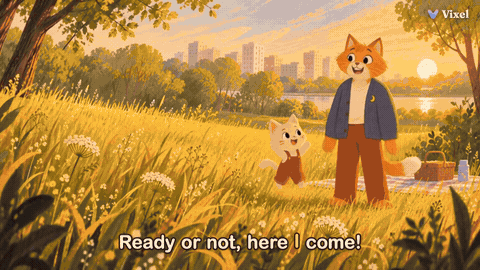
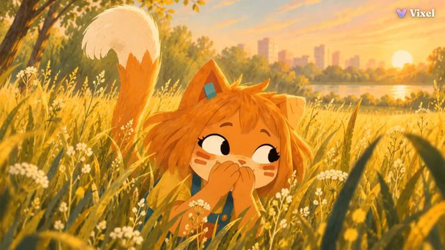
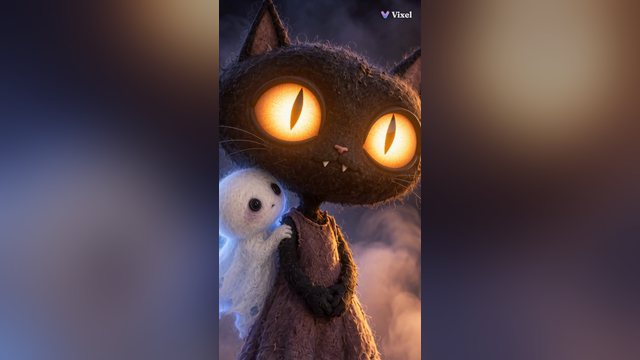
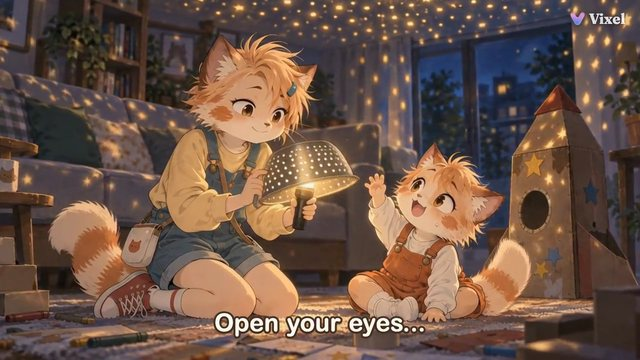
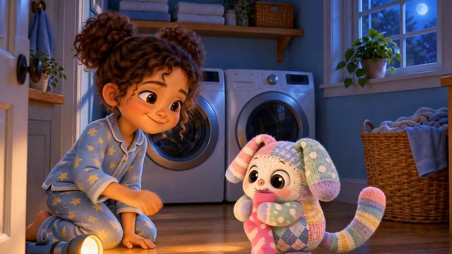
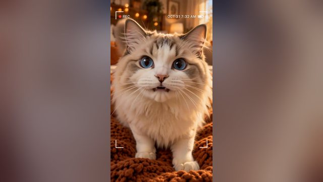

<p align="center">
  <a href="https://www.vixelai.com/case-studies">
    
  </a>
</p>

<h1 align="center">Vixel AI: turn your story into an AI short film</h1>

<p align="center">
  Script, characters, storyboard, shots and the final cut in one Work.<br>
  Direct it in the browser, or from Claude Code, Codex or any MCP client.
</p>

<p align="center">
  <a href="https://github.com/Vixel-AI/vixel-plugins#claude-code"></a>
  <a href="https://github.com/Vixel-AI/vixel-plugins#codex"></a>
  <a href="https://drama.vixelai.com/creator/mcp?source=github&entry=org_profile_badge"></a>
  <a href="https://github.com/Vixel-AI/vixel-plugins#any-agent-the-skill-only"></a>
  <a href="https://drama.vixelai.com/creator?source=github&entry=org_profile_badge"></a>
</p>

<p align="center">
  <a href="https://github.com/Vixel-AI/vixel-plugins"><b>Connect your agent</b></a> ·
  <a href="https://drama.vixelai.com/creator?source=github&entry=org_profile"><b>Start in the browser</b></a> ·
  <a href="https://www.vixelai.com/case-studies"><b>Watch the films</b></a>
</p>

## Make AI films with your agent: MCP, Claude Code plugin, Codex plugin

Paste this line into Claude Code, Codex, Cursor or another agent that can run
commands. It reads Vixel's official setup steps for that agent and connects
your Vixel account. You approve access in your own browser.

```text
Fetch and execute the appropriate instructions to set me up for Vixel from https://drama.vixelai.com/agent-setup.md
```

Setup is free. It does not create a Work, generate media or spend credits.
Then ask for a film:

```text
Make a 60-second picture-book film about a kitten whose tail gives away her hiding spot.
Show me the script first.
```

Your agent drafts a script for your approval, plans characters and shots, and
shows a free quote before each image or video. It generates only within the
credit limit you approve, and it never posts to social channels.

<details>
<summary><b>Install by hand</b></summary>

| Client | Steps |
| --- | --- |
| Claude Code | `/plugin marketplace add Vixel-AI/vixel-plugins`, then `/plugin install vixel@vixel`, then `/mcp` → `vixel` → Authenticate |
| Codex | `codex plugin marketplace add https://github.com/Vixel-AI/vixel-plugins`, then `codex plugin add vixel-creator@vixel-ai` |
| Any agent (Skill only) | `npx skills@1.7.0 add Vixel-AI/vixel-plugins` |
| Claude app (web, desktop, mobile) | Settings → Connectors → Add custom connector, name it `Vixel`, paste `https://drama.vixelai.com/api/mcp`, then Connect (custom connectors depend on your Claude plan) |
| Any MCP client | Remote server `https://drama.vixelai.com/api/mcp` with browser sign-in |

More in [Vixel-AI/vixel-plugins](https://github.com/Vixel-AI/vixel-plugins) and
on the [MCP & CLI page](https://www.vixelai.com/mcp).

</details>

## AI animation and short films made with Vixel

Every film below was made by the Vixel team. The first five were each made in
one Vixel Work directed from the Vixel CLI, which calls the same Film tools your
agent reaches through MCP.

<table>
  <tr>
    <td width="33%" valign="top">
      <a href="https://www.vixelai.com/case-studies/wheres-mimi"></a><br>
      <b><a href="https://www.vixelai.com/case-studies/wheres-mimi">Where's Mimi?</a></b><br>
      <sub>Storybook animation · 1:13 · 16:9</sub>
    </td>
    <td width="33%" valign="top">
      <a href="https://www.vixelai.com/case-studies/too-cute-to-scare"></a><br>
      <b><a href="https://www.vixelai.com/case-studies/too-cute-to-scare">Too Cute to Scare</a></b><br>
      <sub>Stop-motion style Halloween short · 1:16 · 9:16</sub>
    </td>
    <td width="33%" valign="top">
      <a href="https://www.vixelai.com/case-studies/mika-moon-mission"></a><br>
      <b><a href="https://www.vixelai.com/case-studies/mika-moon-mission">Mika: The Moon Mission</a></b><br>
      <sub>Animated short for kids · 1:14 · 16:9</sub>
    </td>
  </tr>
  <tr>
    <td width="33%" valign="top">
      <a href="https://www.vixelai.com/case-studies/where-do-the-socks-go"></a><br>
      <b><a href="https://www.vixelai.com/case-studies/where-do-the-socks-go">Where Do the Socks Go?</a></b><br>
      <sub>3D animated bedtime story · 1:08 · 16:9</sub>
    </td>
    <td width="33%" valign="top">
      <a href="https://www.vixelai.com/case-studies/my-perfect-halloween-cat-vlog"></a><br>
      <b><a href="https://www.vixelai.com/case-studies/my-perfect-halloween-cat-vlog">My Perfect Halloween: A Cat Vlog</a></b><br>
      <sub>Vertical cat vlog · 1:24 · 9:16</sub>
    </td>
    <td width="33%" valign="top">
      <a href="https://www.vixelai.com/case-studies/why-is-the-ocean-blue"></a><br>
      <b><a href="https://www.vixelai.com/case-studies/why-is-the-ocean-blue">Why Is the Ocean Blue?</a></b><br>
      <sub>Children's animation · 0:40 · 16:9</sub>
    </td>
  </tr>
</table>

Each case study shows the finished film, its creative approach and a practice
brief you can adapt. [See all films →](https://www.vixelai.com/case-studies)

## Script to storyboard to video in the browser

1. Start with a small idea or script.
2. Review your story, characters and storyboard.
3. Generate and review individual shots, then assemble your sequence.

[Open Vixel Creator](https://drama.vixelai.com/creator?source=github&entry=org_profile) ·
[Make your first AI short film](https://www.vixelai.com/guides/make-your-first-ai-short-film) ·
[Script to storyboard](https://www.vixelai.com/guides/script-to-storyboard) ·
[Keep characters consistent](https://www.vixelai.com/guides/consistent-characters)

AI output may need revisions. Opening a practice brief does not generate media;
image and video generation uses credits.
[Check current plans and limits](https://drama.vixelai.com/plans).

## About and official channels

- [About Vixel](https://www.vixelai.com/about) · [What is Vixel AI?](https://www.vixelai.com/what-is-vixel-ai)
- [Website](https://www.vixelai.com) · [X · @vixel_ai](https://x.com/vixel_ai)
- General questions: [hello@vixelai.com](mailto:hello@vixelai.com)
- Product help: [support@vixelai.com](mailto:support@vixelai.com)
